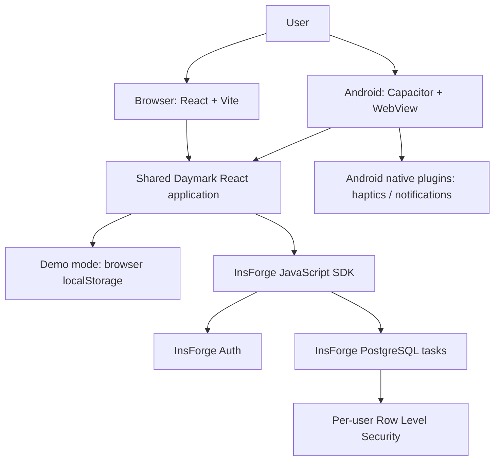

# Daymark — Technical Stack, Architecture & Release Guide

**Project:** Daymark — an offline-friendly task management application  
**Repository:** https://github.com/inputtext/daymark  
**Cloud backend:** InsForge project `daymark-todo`  
**Android app ID:** `com.piyush.daymark`  
**Document version:** 1.0 — 17 October 2026  
**Status note:** Distinguishes shipped code, open pull requests and future work. All listed dependency ranges were inspected in GitHub `chore/android-baseline`; runtime versions are resolved by `package-lock.json`.

---

## 1. Executive summary

Daymark is a **shared React/Vite web app** that can be distributed as a website or packaged as an Android application via **Capacitor**. InsForge supplies authentication and cloud-backed PostgreSQL task persistence. Demo-mode tasks currently use browser `localStorage`. The Android version loads the same built web assets inside an Android WebView, with Capacitor as the bridge to native Android functionality.

The initial Android build has been opened and tested on a **Google Pixel 9**. **That does not yet validate all native plugins, cloud sync or production readiness.**

## 2. Verified technology stack

| Area | Technology | Verified use or status |
|---|---|---|
| UI framework | React `^19.0.0`, React DOM `^19.0.0` | Shared app screens/components |
| Language | JavaScript + JSX | App and utility modules |
| Dev server/bundler | Vite `^6.0.5`, `@vitejs/plugin-react` `^4.3.4` | Local dev, production bundles |
| Styles | CSS, Tailwind CSS `^3.4.17`, PostCSS, Autoprefixer | Current interface; Expressive overrides in PR #2 |
| Iconography | `lucide-react` `^0.468.0` | Navigation and actions |
| Backend SDK | `@insforge/sdk` (`latest` declaration) | Browser auth and database CRUD |
| Backend/database | InsForge + PostgreSQL | Cloud tasks; owner-restricted RLS migration |
| Demo persistence | `localStorage` | Local-only demo tasks; not cloud synchronized |
| Native wrapper | Capacitor core/Android/CLI `^8.5.3` | Android Studio project, WebView bridge |
| Haptics plugin | `@capacitor/haptics` `^8.0.2` | Installed in Android baseline; native interaction testing pending |
| Local notifications plugin | `@capacitor/local-notifications` `^8.3.1` | Installed; task reminder scheduling not implemented |
| Android native | Java `MainActivity extends BridgeActivity`, Gradle / Android SDK | `android/` native shell and build configuration |
| Android targets | minSdk 24, compileSdk 36, targetSdk 36 | From `android/variables.gradle` |
| Android build tools | AGP 8.13.0; Gradle wrapper 8.14.3 | From native Gradle files |
| Source control | GitHub | Feature branches and pull requests |
| Automated checks | GitHub Actions + Node built-in test runner | Added in PR #1, builds Vite and runs unit tests |
| Web deployment | InsForge deployments (Vercel-backed hosting) | Manual publish using InsForge CLI |
| Play distribution | Google Play Console / Android App Bundle (future) | Not yet published |

**Note:** In `package.json`, InsForge uses `"latest"`, which can cause future installs to drift. Before release, pin or deliberately manage SDK versions and keep the lockfile synchronized.

## 3. High-level architecture



This is **not** a React Native application. Capacitor packages the React **web** UI, so web components and CSS stay reusable. Native Android plugins are available through JavaScript bridges; complex Android-only interfaces may need native Java/Kotlin code.

## 4. Important files / directories

```text
Daymark/
├── src/
│   ├── App.jsx             # Current dashboard, auth, task UI
│   ├── main.jsx            # React app entry point
│   ├── styles.css          # Existing styles
│   └── lib/
│       ├── insforge.js     # Browser SDK client / env config
│       └── tasks.js        # Task search, grouping, dates, demo data
├── tests/                  # Node test runner tests
├── migrations/             # InsForge SQL migrations and RLS
├── android/                # Capacitor Android Studio project (baseline PR)
├── capacitor.config.json   # appId, appName, webDir
├── package.json            # dependencies and scripts
├── package-lock.json       # resolved npm dependency graph
├── vite.config.js
├── vercel.json              # SPA rewrite configuration
├── .env.example             # public client env variable names only
└── README.md
```

Additional files live **on separate branches until merged**:

- PR #1: `src/lib/smartTask.js`, `tests/smartTask.test.mjs`, and Smart Task Entry UI.
- PR #2: `src/expressive.css`, appearance palette panel, bottom navigation and design documentation.
- PR #3: `src/lib/haptics.js`, dedicated haptic tests and haptic settings. Native vibration on Pixel 9 still requires verification and likely a direct SDK import after dependency integration.
- PR #4: native `android/` source, `capacitor.config.json`, Capacitor/plugin dependencies and lockfile.

## 5. How task data works today

**Cloud mode:** `src/lib/insforge.js` creates an `@insforge/sdk` client when both `VITE_INSFORGE_URL` and `VITE_INSFORGE_ANON_KEY` exist at build time. `App.jsx` handles sign-up/sign-in and selects/inserts/updates/deletes rows in `public.tasks`. InsForge PostgreSQL Row Level Security limits each authenticated user to their own rows. A successful browser authentication flow should be tested on Android too, especially any redirect / verification links.

**Demo mode:** Data is stored in browser `localStorage` under `daymark:demo-tasks:v1`. A browser's demo data is not automatically shared with an Android WebView or cloud account. Demo mode is not a full offline-first sync system.

**Privacy/security:** The public anon key may be included in the browser bundle and must be protected by RLS. **Never expose an InsForge admin API key, service key or signing credentials in `VITE_*` variables or Git.** RLS must be tested for more than one user before production.

## 6. Feature status / planned roadmap

| Feature | Current status |
|---|---|
| Create/edit/delete/complete tasks, priority/due-date, views | Present in original React app |
| Sign-in/sign-up via InsForge | SDK integration present; verify deployment/auth redirects |
| Demo mode | Available using browser localStorage |
| Smart Task Entry | PR #1 open; offline rules, not generative AI |
| Material 3 Expressive-inspired design | PR #2 open; CSS, palettes, motion, mobile UI |
| Semantic haptic feedback settings | PR #3 open; native hardware behavior not verified |
| Android app on Pixel 9 | Local Capacitor build tested by developer; PR #4 open |
| True Material You wallpaper dynamic color | Not implemented (would need Android bridge) |
| Rich Kotlin haptic compositions | Not implemented |
| Local task reminders / notifications | Plugin installed; reminder scheduling not implemented |
| Offline-first cloud sync/conflict resolution | Not implemented |
| On-device LLM / speech agent | Not implemented; design exploration only |
| Store-ready releases | Not implemented / not yet published to Google Play |

The planned on-device AI layer should not depend on paid inference APIs, but may require local model downloads, compatible hardware and additional storage. Rule-based task parsing is not equivalent to an LLM.

## 7. Why Capacitor instead of Expo?

**Decision:** Continue with Capacitor because Daymark was built as a working **React DOM + Vite** web application before Android development began.

| Criterion | Daymark + Capacitor | React Native + Expo |
|---|---|---|
| Reuse existing JSX DOM + CSS | Mostly yes, via WebView | Not directly: React Native uses native primitives (`View`, `Text`, etc.) |
| Existing Vite build pipeline | Preserved | Typical Expo projects use React Native tooling instead |
| Same visual code on website and Android | Strong reuse | Requires a React Native UI redesign or a special web strategy |
| Native UI look and feel | Must be deliberately designed; can add native plugins | Native-rendered components, useful for some platform-native interactions |
| Haptics & notifications | Capacitor plugins / custom Java or Kotlin | Expo modules and custom native integrations |
| Local Android builds | Android Studio / Gradle | Expo development builds or native workflows / EAS |
| Migration cost for Daymark now | Low; working Android app already exists | Higher; significant existing DOM/CSS UI rewrite |

**Expo is a good option**, not an inferior framework. If starting a fully native UI app from scratch, Expo might be preferable. But rewriting Daymark's web UI into React Native would slow down the current project and create two different presentation implementations. Capacitor is therefore the pragmatic choice **for Daymark's current goals**, with the trade-off that certain platform-native interactions need more careful implementation.

Reference: https://docs.expo.dev/get-started/create-a-project/ and https://capacitorjs.com/docs/basics/workflow

## 8. Development commands

All commands below run in the **project root** (where `package.json` and `capacitor.config.json` are), **not** inside `android/`.

```powershell
npm ci
npm run dev          # opens Vite localhost, possibly :5173 or :5174
npm test
npm run build        # creates dist/
npx cap sync android # copies the current dist/ into Android native project
npx cap open android # open Android Studio
```

In Android Studio select your Pixel 9 and the `app` configuration, then press **Run**. An Android app installed on the phone is a separate artifact from the deployed website; publishing the website alone does not update the installed app.

## 9. Git workflow and merge order

Repository: https://github.com/inputtext/daymark

- **PR #4** — `chore/android-baseline` → `main`: import the user's tested native Android baseline.
- **PR #1** — `feat/offline-smart-task-entry` → `main`: Smart Task Entry and CI checks.
- **PR #2** — `feat/material-expressive-ui` → `feat/offline-smart-task-entry`: stacked on #1 to minimize conflicts.
- **PR #3** — `feat/haptic-feedback-engine` → `feat/material-expressive-ui`: stacked on #2 to minimize conflicts.

Recommended merge plan: review/merge #4, then #1; retarget #2 to `main` after #1 is merged; retarget #3 to `main` after #2 is merged. Review CI and diff on each PR. Merging doesn't automatically deploy the frontend. Before switching your local branches, verify `git status` and preserve local changes.

## 10. Why localhost and the hosted app differ

- `npm run dev` serves **your current local source files** with Vite hot-reload. The port may be `5174` if `5173` is occupied.
- The hosted `https://w4k4rhd3.insforge.site/` serves the files from the **last InsForge frontend deployment**.
- Commits and PRs in GitHub do not update that deployed version unless a deployment workflow is explicitly configured.
- A Capacitor Android build ships the **last bundled `dist/` assets copied by `npx cap sync android`**.

**After merging and verifying the desired version**, publish from the branch checked out in your local root:

```powershell
npx @insforge/cli current
npx @insforge/cli deployments env list  # confirm VITE_* variables exist in deployment env
npm ci
npm test
npm run build
npx @insforge/cli deployments deploy .
```

The deploy action must receive the **source directory**, not `dist/`. If env vars do not exist in the InsForge deployment environment, configure their *public* client values via `npx @insforge/cli deployments env set ...` before deploying. The `.env` file is intentionally excluded from upload. After deployment, hard-refresh the hosted app and compare behavior; use its reported release URL.

## 11. Native haptic design and constraints

Target semantic interactions: light selection tick for navigation; discrete button action pulse; distinct completion pulse; stronger warning confirmation; error pulse. User preferences: **Off, Subtle, Balanced, Strong** (initially implemented in PR #3).

The installed `@capacitor/haptics` package alone does **not** make every tap vibrate. Client code must invoke the plugin. Rich custom amplitude and timing may need Android Kotlin/Java `VibrationEffect` or suitable haptic constants, and device-support checks. Respect OS haptics settings, quiet experiences, accessibility, and reduce-motion settings. Validate every level **on the actual Pixel 9**. Web browsers may not implement the Vibration API.

## 12. Android / Google Play preparation

Before Google Play production, do a signed release candidate and verify requirements in the official Play Console documentation. Keep these items in the checklist:

- Unique package ID (`com.piyush.daymark`) and monotonically increasing `versionCode`.
- API target compatibility (baseline targets API 36), permissions audit and recent SDK versions.
- Adaptive launcher icon, branded splash, screenshots, feature graphic, store copy and accessibility review.
- Secure upload signing key; keystores must **never** be committed to a public repo. The Android baseline's generated `.gitignore` currently has the keystore ignore rules commented out — fix this before creating keys.
- Privacy policy, accurate Data safety form, sign-in test credentials if needed, account deletion inside and outside the app.
- Real-device tests: login, task persistence, time zones, offline behavior, back-navigation, modal keyboard resizing, notifications permission, haptics, app lifecycle and battery consumption.
- Internal/closed testing requirements for the specific Play developer account, then signed **Android App Bundle** (`.aab`) release.

Use https://developer.android.com/studio/publish and https://support.google.com/googleplay/android-developer/ for current official requirements.

## 13. Quality assurance / deployment checklist

- [ ] Merge selected PRs in dependency order with passing CI.
- [ ] `npm ci`, `npm test`, `npm run build` succeed.
- [ ] Verify Smart Task Entry in demo and signed-in modes.
- [ ] Verify light/dark and all palettes at phone and desktop sizes.
- [ ] Test accessibility: keyboard, focus, labels, contrast, system reduced motion.
- [ ] Confirm no `.env`, admin keys, SDK local paths or keystores are tracked.
- [ ] Test RLS with two distinct cloud users.
- [ ] Set deployment `VITE_INSFORGE_URL` and `VITE_INSFORGE_ANON_KEY` values.
- [ ] Deploy source to InsForge and verify hosted URL.
- [ ] `npx cap sync android` from project root and run on Pixel 9.
- [ ] Test real haptics / disable control and native notifications.
- [ ] Prepare release version, signing process and Play Console assets.

---

## 14. Official links

- React: https://react.dev/
- Vite: https://vite.dev/
- Tailwind CSS: https://tailwindcss.com/
- Capacitor: https://capacitorjs.com/docs/
- Capacitor Haptics: https://capacitorjs.com/docs/apis/haptics
- Capacitor Local Notifications: https://capacitorjs.com/docs/apis/local-notifications
- Expo: https://docs.expo.dev/
- InsForge: https://insforge.dev/
- Android Developers: https://developer.android.com/
- GitHub repository: https://github.com/inputtext/daymark

**Documentation intent:** A source-of-truth engineering handoff, not a claim that planned Android or AI features are already implemented.